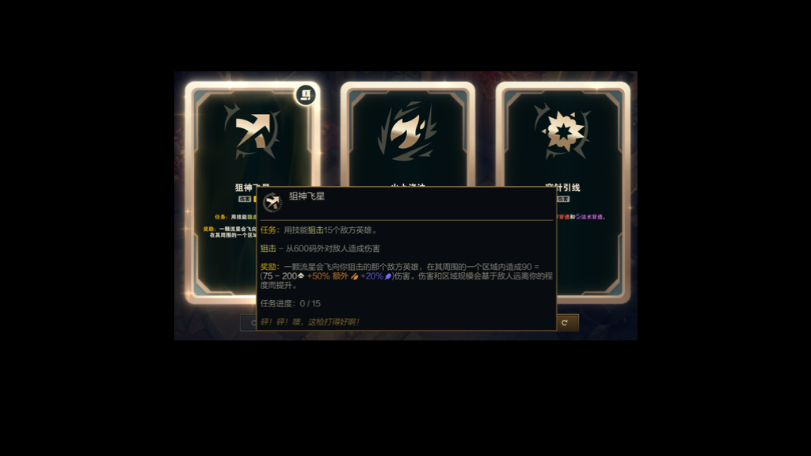

# macOS support (preview)

Mac port contributed by **ironieser**, based on
[valkia/aramgg_client](https://github.com/valkia/aramgg_client).
Upstream attribution and commit history are retained. This branch does not add
or change the upstream project's license.

## Requirements and build

- Apple silicon Mac running macOS 14 or newer.
- Node 22, npm 10, and Xcode Command Line Tools.

```sh
npm ci
npm run dev
# Or build a local Apple silicon application:
npm run pack:mac
```

The packaging script prepares the three locale datasets and produces a ZIP in
`build/`. Extract it to obtain `aramgg_client.app`. The native Node-API capture
module is built by `predev`/`prebuild`. `pack:mac` always rebuilds it explicitly
(it does not rely on npm `prebuild`), verifies that it loads and exposes the
expected exports, and checks the packaged copy under
`Contents/Resources/mac-capture/`; packaging fails if any step is missing. Local
packages are ad-hoc signed, not Developer ID signed or notarized. Mac application
auto-update, the manual installer link and the check-update action are hidden on
macOS because the upstream update feed serves Windows builds; Windows keeps its
existing update and manual-download fallback. Versioned recommendation-data
refresh remains separate from application updates.
No public Mac binary release is included in this contribution.

## Permissions and use

1. Start League and ARAMGG. LCU discovery is process-first; selecting
   `League of Legends.app` is an optional fallback, not a required setting.
2. Enable **Privacy & Security → Screen Recording** for the application when
   prompted, then restart it. The app requests access once per run when it is
   not granted; macOS only shows the prompt if it has never asked before, so a
   previously denied or stale entry must be fixed in System Settings. Automatic
   capture reads only the Riot game window; it does not fall back to desktop
   contents or capture audio.
3. Set League's **Video → Window Mode** to **Borderless** (or Windowed).
   Exclusive fullscreen is not supported: the game takes over the display, its
   windows are not composited, and window capture returns black frames (observed
   on a two-display setup). Overlays also cannot appear above exclusive
   fullscreen. Change the mode before the match starts; switching mid-match may
   leave the game window in the fullscreen state.
4. Optionally enable **Tab guide** in the assistant. This needs **Input Monitoring**.
   Hold unmodified Tab while League is in front to show the in-game quick guide;
   release it to hide the guide. The game's own scoreboard still receives the key.
5. To reposition the guide, use **Open current champion guide**, then drag its
   title bar. The position is saved. A guide opened by Tab is click-through.

The listen-only native keyboard handler only retains Tab pressed/released state,
ignores other key values, and does not record typed text. It stops outside an
active match, when the feature is disabled, and on quit. Renderer IPC stays
behind the existing trusted sender checks; sandboxing and context isolation
remain enabled.

Replacing an ad-hoc signed build may invalidate permissions even if Settings
still shows them enabled. Quit the application, remove its old entry, add the
current application, and restart. A stable release signing identity is still
needed before shipping a supported installer.

## Behavior

- ScreenCaptureKit selects the largest window owned by the exact Riot game
  bundle and captures it independently of desktop Spaces. Work runs off the
  JavaScript main thread with a bounded timeout.
- Nonactivating Mac panels appear across fullscreen Spaces above the game's
  observed window level. Requested visibility is tracked separately from native
  occlusion, with bounded reordering that does not reopen manually hidden panels.
- OCR preserves left/center/right title ordering. On macOS only, existing
  recommendations can remain visible while hover tooltips obscure titles if all
  three card frames are still present; this evidence does not identify new
  augments. Windows does not compute card frames and keeps its clearing logic.
- In-game quick guide (this PR): a complete core-item combination, later items,
  skill order and two augment recommendations per rarity, based on common
  champion data rather than live inventory. The guide uses the current match
  identity; pending opens are cancelled on Tab release or state change. Opening
  the current champion guide reuses the upstream manual-open semantics.
- Hold-Tab is Mac-only (`supported: false` elsewhere). The in-game guide and
  the **Open current champion guide** button are shared UI and also apply to
  Windows; they have not been verified on Windows.
- Windows behavior remains on its platform path: every change in this port is
  guarded by `process.platform === 'darwin'` or only runs on macOS. Shared UI
  changes (in-game quick guide, hold-Tab, candidate layout) are proposed in a
  separate PR. Local builds retain the upstream production-upload gate.

## Validation

```sh
npm run test:unit
npm run lint
npm run type-check
npm run build
npm run test:augment-ocr
# Clean native state, then package and run the packaged smoke probe:
rm -rf .runtime/mac-capture
npm run pack:mac
npm run test:packaged-mac
```

Verified on an Apple M2 Pro (macOS 15.0) with the NA League client and Chinese
game text. Only macOS was available; **no Windows environment was used**.

Automated (re-run on 2026-11-03 after rebasing onto upstream v0.2.19):

- 470 unit tests (83 files), lint, type checks and renderer build pass.
- PaddleOCR fixtures pass for full, partial and unmatched title regions.
- From a clean `.runtime/mac-capture`, `npm run pack:mac` compiles, loads and
  verifies the native module and the packaged copy.
- `npm run test:packaged-mac` passes: all four windows become ready in the
  packaged app and packaged OCR reads the fixture (`[1390, 1129]`; augment 1032
  is no longer in the bundled season data, so the check only requires an
  ordered subset of the fixture IDs).
- The unit suite was additionally run on macOS with `process.platform` faked as
  `win32`; failures matched upstream master under the same conditions (native
  `sharp`/temp-dir environment issues), with no new platform-logic failures.
  This is not a substitute for running on Windows.

Live re-test on 2026-11-03 after the rebase (packaged app, NA client,
Chinese text, borderless mode on a two-display setup):

- LCU connection, champion-select bench recommendations and item-set sync work.
- First augment choice recognized all three cards (95% confidence, ~270 ms);
  two rerolls updated the recommendations; overlays cleared after selection.
- In exclusive fullscreen the same build captured only black frames (see
  Permissions and use); switching to borderless before the next match fixed it.

Manual (earlier live testing of the platform port):

- Local packaged application launches, connects to LCU, captures game-window
  frames and detects card selections/rerolls. App quit/relaunch and deep code
  signature verification were checked.
- Both recommendation panels were observed over the game during live testing.
- A sanitized card-only hover fixture covers retention without publishing desktop
  contents or player identity:



Not yet verified:

- Windows packaging and window smoke (`npm run test:packaged-windows`) — no
  Windows environment; to be accepted through the repository CI.
- Hover-tooltip retention was not re-checked in the 2026-11-03 live test.
- Screen Recording first-run prompt: implemented and unit tested, not yet
  verified with a fresh permission state.
- Forge/anvil choice screens, additional resolutions/displays, and repeated
  first-selection and fullscreen/collapse recovery checks.
- Intel Macs (not claimed).
- Developer ID signing, notarization, and a Mac update channel.
