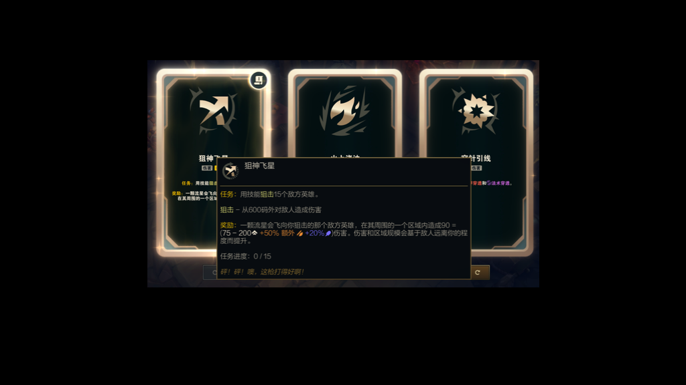

# macOS support (preview)

Mac port contributed by **ironieser**, based on
[valkia/aramgg_client](https://github.com/valkia/aramgg_client).
Upstream attribution and commit history are retained. This branch does not add
or change the upstream project's license.

## Requirements and build

- Apple silicon Mac running macOS 14 or newer.
- Node 22, npm 10, and Xcode Command Line Tools.

```sh
npm ci
npm run dev
# Or build a local Apple silicon application:
npm run pack:mac
```

The packaging script prepares the three locale datasets and produces a ZIP in
`build/`. Extract it to obtain `aramgg_client.app`. The native Node-API capture
module is built by `predev`/`prebuild` and bundled as a Mac-only resource. Local
packages are ad-hoc signed, not Developer ID signed or notarized. Mac application
auto-update is disabled because the upstream update feed serves Windows builds;
versioned recommendation-data refresh remains separate from application updates.
No public Mac binary release is included in this contribution.

## Permissions and use

1. Start League and ARAMGG. LCU discovery is process-first; selecting
   `League of Legends.app` is an optional fallback, not a required setting.
2. Enable **Privacy & Security → Screen Recording** for the application when
   prompted, then restart it. Automatic capture reads only the Riot game window;
   it does not fall back to desktop contents or capture audio.
3. Optionally enable **Tab guide** in the assistant. This needs **Input Monitoring**.
   Hold unmodified Tab while League is in front to show the guide; release it to
   hide the guide. The game's own scoreboard still receives the key normally.
4. To reposition the guide, use **Open current champion guide**, then drag its
   title bar. The position is saved. A guide opened by Tab is click-through.

The listen-only native keyboard handler only retains Tab pressed/released state,
ignores other key values, and does not record typed text. It stops outside an
active match or when the feature is disabled. Renderer IPC stays behind the
existing trusted sender checks; sandboxing and context isolation remain enabled.

Replacing an ad-hoc signed build may invalidate permissions even if Settings
still shows them enabled. Quit the application, remove its old entry, add the
current application, and restart. A stable release signing identity is still
needed before shipping a supported installer.

## Behavior

- ScreenCaptureKit selects the largest window owned by the exact Riot game
  bundle and captures it independently of desktop Spaces. Work runs off the
  JavaScript main thread with a bounded timeout.
- Nonactivating Mac panels appear across fullscreen Spaces above the game's
  observed window level. Requested visibility is tracked separately from native
  occlusion, with bounded reordering that does not reopen manually hidden panels.
- OCR preserves left/center/right title ordering. Existing recommendations can
  remain visible while hover tooltips obscure titles if all three card frames
  are still present; this evidence does not identify new augments.
- The current champion guide uses the current match identity rather than the
  previous match's cached hero. Pending opens are cancelled on release or state
  change. Display-preference changes apply immediately.
- In-game quick reference shows a complete core-item combination, later items,
  skill order and two augment recommendations per rarity. It is based on common
  champion data, not live inventory or selected-augment-aware recommendations.
- Champion selection retains the full detail page. Candidate recommendations
  use three columns and a three-row viewport; extra candidates scroll vertically.
- Windows behavior remains on its platform path. Tab hold support is Mac-only.
  Local builds retain the upstream production-upload gate.

## Validation

```sh
npm run test:unit
npm run lint
npm run type-check
npm run build
npm run test:augment-ocr
# Separate packaged smoke probe (see current limitation below):
npm run test:packaged-mac
```

Verified on Apple silicon with the NA League client and Chinese game text:

- 267 unit tests, lint, type checks, native compilation and renderer build pass.
- PaddleOCR fixtures pass for full, partial and unmatched title regions.
- Local packaged application launches, connects to LCU, captures game-window
  frames and detects card selections/rerolls. App quit/relaunch and deep code
  signature verification were checked.
- Both recommendation panels were observed over the game during live testing.
- The compact Teemo guide fits the 360×640 window without clipping. The tester
  subsequently confirmed that holding/releasing Tab shows/hides the guide.
- A sanitized card-only hover fixture covers retention without publishing desktop
  contents or player identity:



Remaining validation before a supported Mac release:

- Forge/anvil choice screens, additional resolutions/displays, and repeated
  first-selection and fullscreen/collapse recovery checks.
- The three-column candidate layout in a real champion-selection session.
- Windows packaged regression testing and Intel Mac support (not claimed).
- Developer ID signing, notarization, and a Mac update channel.
- The shell-driven packaged smoke test previously aborted in LaunchServices in
  the restricted test environment before reaching application code. Manual
  packaged testing does not turn that automated check into a passing result.
